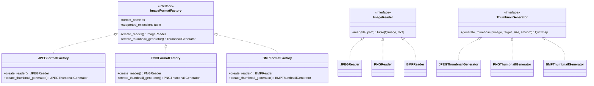
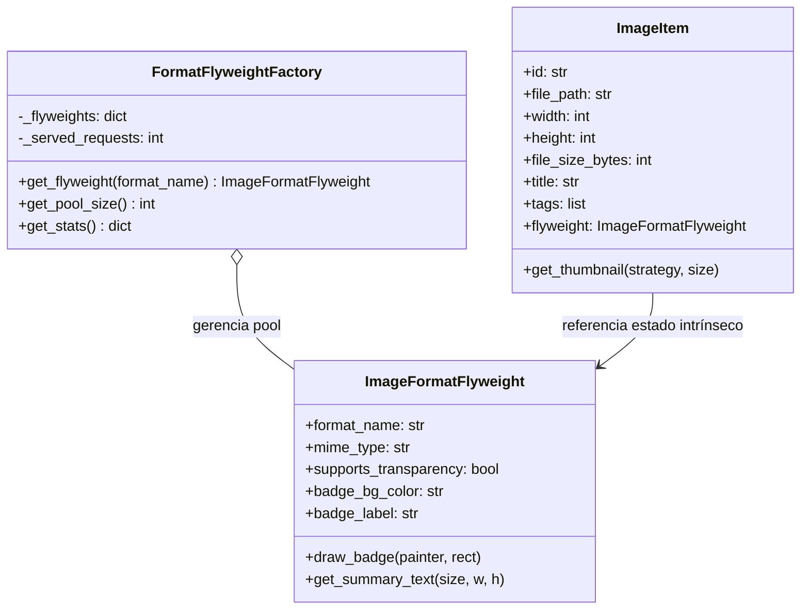
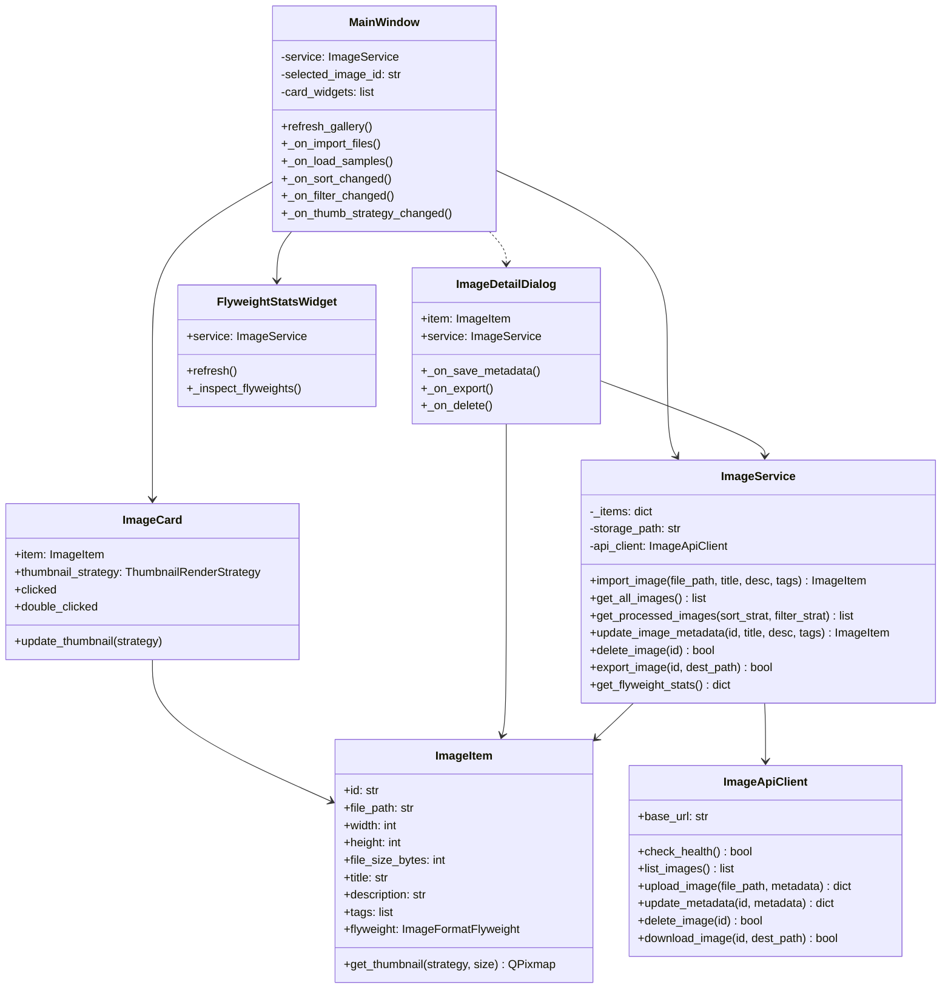
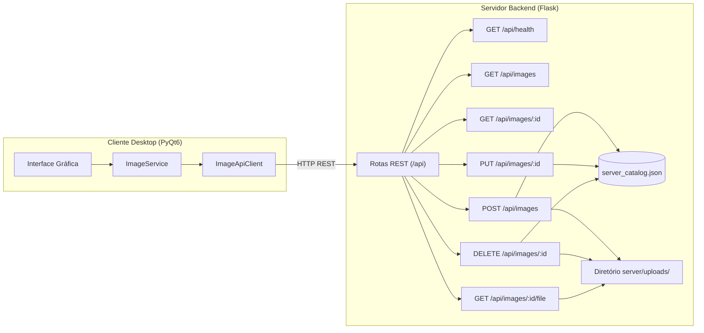

# Organizador de Imagens (Projeto 10)

**Disciplina:** Paradigmas de Programação  
**Turma:** CC5AN  
**Professor:** Alex Carneiro  
**Módulo:** Cliente Desktop QT (`PyQt6`) & Servidor Flask (`server/`)

---

## 📌 Sumário
1. [Visão Geral do Projeto](#-visão-geral-do-projeto)
2. [Design Patterns Implementados](#-design-patterns-implementados)
   - [Criacional — Abstract Factory](#1-criacional--abstract-factory)
   - [Estrutural — Flyweight](#2-estrutural--flyweight)
   - [Comportamental — Strategy](#3-comportamental--strategy)
3. [Diagramas de Classes](#-diagramas-de-classes)
   - [Diagrama de Classes do Cliente (UML)](#diagrama-de-classes-do-cliente-qt)
   - [Diagrama de Classes / Arquitetura do Servidor Flask](#diagrama-de-arquitetura-do-servidor-flask)
4. [Requisitos do Sistema](#-requisitos-do-sistema)
   - [Requisitos Funcionais (RF)](#requisitos-funcionais-rf)
   - [Requisitos Não-Funcionais (RNF)](#requisitos-não-funcionais-rnf)
5. [Cenários de Teste e Condições de Aceitação](#-cenários-de-teste-e-condições-de-aceitação)
6. [Instruções de Instalação e Execução](#-instruções-de-instalação-e-execução)
7. [Estrutura do Repositório](#-estrutura-do-repositório)

---

## 📖 Visão Geral do Projeto

O **Organizador de Imagens** é uma aplicação desktop desenvolvida em Python e PyQt6 com foco rigoroso na aplicação observável de padrões de projeto (*GoF Design Patterns*). 

O sistema oferece um **CRUD completo** de imagens e metadados, suporte a formatos populares (**JPEG**, **PNG**, **BMP**), persistência em formato JSON (sem dependência de banco de dados externo ou serviços em nuvem, conforme as diretrizes acadêmicas), e desacoplamento para comunicação futura ou simultânea com o servidor **Flask**.

---

## 🧩 Design Patterns Implementados

De acordo com o documento de requisitos da disciplina, a solução implementa observavelmente:

### 1. Criacional — Abstract Factory
* **Finalidade:** Criar famílias de objetos compatíveis (leitores de arquivo e geradores de miniaturas) específicos para cada formato de imagem suportado.
* **Componentes:**
  * **Fábrica Abstrata (`ImageFormatFactory`):** Define a interface para criação do leitor (`create_reader()`) e do gerador de miniatura (`create_thumbnail_generator()`).
  * **Fábricas Concretas:**
    * `JPEGFormatFactory`: Cria `JPEGReader` e `JPEGThumbnailGenerator`.
    * `PNGFormatFactory`: Cria `PNGReader` (com suporte a canal alfa e transparência) e `PNGThumbnailGenerator`.
    * `BMPFormatFactory`: Cria `BMPReader` e `BMPThumbnailGenerator`.
  * **Seletor de Fábricas (`ImageFormatFactorySelector`):** Mapeia extensões de arquivo (`.jpg`, `.jpeg`, `.png`, `.bmp`) para a fábrica correspondente. Rejeita formatos não suportados lançando `UnsupportedFormatException`.



---

### 2. Estrutural — Flyweight
* **Finalidade:** Compartilhar metadados e recursos visuais intrínsecos de cada formato de imagem entre dezenas ou centenas de miniaturas, eliminando redundância e reduzindo consumo de memória.
* **Componentes:**
  * **Estado Intrínseco (`ImageFormatFlyweight`):** Imutável e compartilhado (nome do formato, tipo MIME, suporte a canal alfa, cor do badge visual, rótulo e descrição).
  * **Estado Extrínseco (`ImageItem`):** Único para cada imagem (caminho em disco, largura, altura, tamanho em bytes, título editável, tags, descrição).
  * **Fábrica Flyweight (`FormatFlyweightFactory`):** Mantém um pool único de instâncias Flyweight por formato (`JPEG`, `PNG`, `BMP`).
  * **Observabilidade:** O componente visual `FlyweightStatsWidget` e o botão **"Inspecionar Ponteiros em Memória"** comprovam em tempo real que todas as imagens de um mesmo formato referenciam exatamente o mesmo endereço de memória (`id(item.flyweight)`).



---

### 3. Comportamental — Strategy
* **Finalidade:** Permitir a troca dinâmica e intercambiável de algoritmos na interface gráfica sem alterar as classes de dados.
* **Famílias de Estratégias:**
  1. **Estratégias de Ordenação (`SortStrategy`):**
     * `SortByNameAscStrategy` (A-Z)
     * `SortByNameDescStrategy` (Z-A)
     * `SortBySizeAscStrategy` (Menor tamanho primeiro)
     * `SortBySizeDescStrategy` (Maior tamanho primeiro)
     * `SortByDateDescStrategy` (Mais recentes)
     * `SortByDateAscStrategy` (Mais antigas)
     * `SortByFormatStrategy` (Agrupado por formato)
  2. **Estratégias de Filtragem (`FilterStrategy`):**
     * `FilterAllStrategy` (Exibe todas)
     * `FilterByFormatStrategy` (Somente JPEG, PNG ou BMP)
     * `FilterBySizeStrategy` (Pequenas < 500KB, Médias 500KB-2MB, Grandes > 2MB)
     * `FilterBySearchStrategy` (Busca em tempo real por título, tags ou descrição)
  3. **Estratégias de Renderização de Miniaturas (`ThumbnailRenderStrategy`):**
     * `SmoothThumbnailStrategy` (Anti-aliasing de alta definição via `SmoothTransformation`)
     * `FastThumbnailStrategy` (Processamento rápido via `FastTransformation`)
     * `CropSquareThumbnailStrategy` (Recorte centralizado quadrado 1:1)
     * `LetterboxThumbnailStrategy` (Ajuste proporcional com moldura padronizada)

```mermaid
classDiagram
    class SortStrategy {
        <<interface>>
        +name: str
        +sort(items: list) list
    }
    class SortByNameAscStrategy
    class SortBySizeDescStrategy
    class SortByDateDescStrategy

    SortStrategy <|.. SortByNameAscStrategy
    SortStrategy <|.. SortBySizeDescStrategy
    SortStrategy <|.. SortByDateDescStrategy

    class FilterStrategy {
        <<interface>>
        +name: str
        +filter(items: list) list
    }
    class FilterAllStrategy
    class FilterByFormatStrategy
    class FilterBySizeStrategy
    class FilterBySearchStrategy

    FilterStrategy <|.. FilterAllStrategy
    FilterStrategy <|.. FilterByFormatStrategy
    FilterStrategy <|.. FilterBySizeStrategy
    FilterStrategy <|.. FilterBySearchStrategy

    class ThumbnailRenderStrategy {
        <<interface>>
        +name: str
        +render(pixmap, target_size) QPixmap
    }
    class SmoothThumbnailStrategy
    class FastThumbnailStrategy
    class CropSquareThumbnailStrategy
    class LetterboxThumbnailStrategy

    ThumbnailRenderStrategy <|.. SmoothThumbnailStrategy
    ThumbnailRenderStrategy <|.. FastThumbnailStrategy
    ThumbnailRenderStrategy <|.. CropSquareThumbnailStrategy
    ThumbnailRenderStrategy <|.. LetterboxThumbnailStrategy
```



---

## 📐 Diagramas de Classes

### Diagrama de Classes do Cliente QT



### Diagrama de Arquitetura do Servidor Flask



---

## 📋 Requisitos do Sistema

### Requisitos Funcionais (RF)
* **RF01 - Importação de Imagens (Create):** O sistema deve permitir ao usuário importar imagens locais nos formatos JPEG, PNG e BMP.
* **RF02 - Visualização e Galeria (Read):** O sistema deve exibir as imagens cadastradas em grade com miniatura, título, formato, dimensões e tamanho em bytes.
* **RF03 - Detalhes em Alta Resolução (Read):** O sistema deve permitir abrir diálogo com a imagem ampliada e distinção explícita entre estado intrínseco (Flyweight) e extrínseco.
* **RF04 - Edição de Metadados (Update):** O sistema deve permitir alterar título, tags e descrição textual da imagem com persistência imediata.
* **RF05 - Exclusão de Imagens (Delete):** O sistema deve permitir remover uma imagem do catálogo com diálogo de confirmação.
* **RF06 - Exportação e Download:** O sistema deve permitir salvar uma cópia da imagem em qualquer diretório escolhido pelo usuário.
* **RF07 - Troca Dinâmica de Ordenação (Strategy):** O sistema deve possibilitar reordenar a galeria por Nome (A-Z, Z-A), Tamanho (crescente/decrescente), Data de Modificação e Formato.
* **RF08 - Filtragem Dinâmica (Strategy):** O sistema deve permitir filtrar imagens por formato (PNG, JPEG, BMP), faixas de tamanho (<500KB, 500KB-2MB, >2MB) e busca por texto em tempo real.
* **RF09 - Troca de Renderização de Miniaturas (Strategy):** O sistema deve permitir alternar em tempo de execução o algoritmo de geração de miniaturas entre Alta Qualidade (Smooth), Rápida (Fast), Recorte Centralizado Quadrado (1:1) e Moldura (Letterbox).
* **RF10 - Tratamento Gracioso de Erros (Resiliência):** O sistema deve validar arquivos e rejeitar formatos inválidos, arquivos corrompidos ou caminhos ausentes com avisos amigáveis e sem travar a interface.
* **RF11 - Observabilidade do Flyweight:** O sistema deve exibir as estatísticas de reutilização de instâncias e permitir inspecionar os ponteiros de memória em tempo real.

### Requisitos Não-Funcionais (RNF)
* **RNF01 - Independência de SGBD Externo:** Não utilizar banco de dados relacional ou NoSQL externo nem serviços em nuvem (dados gravados em JSON).
* **RNF02 - Desacoplamento Arquitetural:** O cliente QT deve ser autossuficiente (modo local resiliente) e compatível com o servidor Flask via cliente REST HTTP.
* **RNF03 - Conformidade com Padrões GoF:** Utilizar estritamente os padrões Abstract Factory, Flyweight e Strategy isolados em seus papéis definidos.
* **RNF04 - Testabilidade:** Toda a suíte de regras de negócio e cenários deve possuir testes unitários automatizados com `pytest`.

---

## 🧪 Cenários de Teste e Condições de Aceitação

Conforme a **página 11** do *Plano de Testes de Qualidade*:

| Identificador | Cenário | Pré-condição | Ação | Condição de Aceitação / Resultado Esperado | Status dos Testes |
|---|---|---|---|---|---|
| **T10.1** | **Importar e visualizar imagens** | Arquivos válidos PNG e JPEG na pasta `sample_images/`. | Clicar em "Importar Imagem(ns)" ou "Carregar Exemplos". | Imagens catalogadas com sucesso, miniaturas renderizadas com badge de formato, metadados persistidos. | ✅ Passou (`test_scenario_t10_1_import_and_view`) |
| **T10.2** | **Arquivo inválido e caminho ausente** | Arquivo `.txt`, arquivo `.jpg` corrompido ou caminho inexistente. | Tentar importar esses arquivos (ou clicar em "Testar Arquivo Inválido"). | Sistema rejeita os arquivos com aviso amigável (`QMessageBox.warning`), nenhuma gravação espúria ocorre e o QT não trava. | ✅ Passou (`test_scenario_t10_2_invalid_file_and_missing_path`) |
| **T10.3** | **Upload, metadados e download** | Imagem catalogada na galeria. | Editar título/tags e clicar em "Exportar / Salvar Cópia". | Metadados atualizados com sucesso no catálogo e arquivo exportado íntegro no disco de destino. | ✅ Passou (`test_scenario_t10_3_upload_metadata_download`) |
| **T10.4** | **Flyweight e Strategy** | Várias imagens de diferentes formatos carregadas. | Alternar estratégias de ordenação, filtro e miniaturas; verificar barra Flyweight. | Ordenação e filtragem refletem imediatamente na galeria; inspeção de memória comprova ponteiros Flyweight idênticos para mesmo formato. | ✅ Passou (`test_scenario_t10_4_flyweight_and_strategy`) |

---

## 🚀 Instruções de Instalação e Execução

### Pré-requisitos
* Python 3.10 ou superior (testado no Python 3.12).
* Nenhuma configuração externa adicional ou SGBD é necessária.

### 1. Criar e ativar o ambiente virtual

```bash
# No Windows (PowerShell):
python -m venv .venv
.\.venv\Scripts\Activate.ps1

# No Linux / macOS:
python3 -m venv .venv
source .venv/bin/activate
```

### 2. Instalar dependências

```bash
pip install -r requirements.txt
```

### 3. Executar o Cliente Desktop QT

```bash
python main.py
```

### 4. Executar os Testes Automatizados de Qualidade (Pytest)

```bash
pytest -v
```
*(Executa todos os 23 testes automatizados cobrindo Abstract Factory, Flyweight, Strategy, CRUD, Cenários T10.1–T10.4 e Servidor Flask).*

### 5. Executar o Servidor Flask (Opcional / Futuro)

```bash
python server/app.py
```
O servidor inicializará em `http://127.0.0.1:5000/api`. O cliente detecta e sincroniza com o servidor automaticamente quando estiver ativo.

---

## 📁 Estrutura do Repositório

```
client-paradigmas/
├── client/
│   ├── patterns/
│   │   ├── abstract_factory.py     # Padrão Abstract Factory (Leitores e Miniaturas por formato)
│   │   ├── flyweight.py            # Padrão Flyweight (Formatos e recursos intrínsecos compartilhados)
│   │   └── strategy.py             # Padrão Strategy (Ordenação, Filtro e Renderização)
│   ├── models/
│   │   └── image_item.py           # Modelo de Domínio (Estado extrínseco + ref ao Flyweight)
│   ├── services/
│   │   ├── api_client.py           # Cliente HTTP REST para comunicação com o backend Flask
│   │   └── image_service.py        # Camada de Serviço (CRUD, persistência JSON, orquestração)
│   └── ui/
│       ├── main_window.py          # Janela Principal com Galeria e Controles de Strategy
│       ├── image_card.py           # Card visual de cada imagem (com badge Flyweight)
│       ├── image_detail_dialog.py  # Visualizador detalhado e formulário de edição (CRUD)
│       ├── flyweight_stats_widget.py # Painel de métricas e inspeção de memória do Flyweight
│       └── style.py                # Folha de estilo e design moderno
├── server/
│   ├── app.py                      # Servidor REST Flask (sem dependência de banco de dados externo)
│   ├── uploads/                    # Diretório de arquivos enviados ao servidor
│   └── data/                       # Persistência do servidor em JSON
├── sample_images/                  # Imagens prontas para demonstração e testes de erro
│   ├── graphic_shapes.png
│   ├── tech_grid.png
│   ├── sunset_landscape.jpg
│   ├── city_night.jpg
│   ├── corrupted_image.jpg         # Imagem com bytes corrompidos para validação do T10.2
│   └── document.txt                # Arquivo não-imagem para teste de rejeição do T10.2
├── tests/
│   ├── test_abstract_factory.py    # Testes unitários do Abstract Factory
│   ├── test_flyweight.py           # Testes unitários do Flyweight
│   ├── test_strategy.py            # Testes unitários do Strategy
│   ├── test_scenarios.py           # Testes dos cenários oficiais T10.1 a T10.4
│   └── test_server.py              # Testes dos endpoints do servidor Flask
├── data/                           # Armazenamento local do catálogo do cliente em JSON
├── requirements.txt                # Dependências do projeto
├── main.py                         # Ponto de entrada do cliente desktop
└── README.md                       # Documentação técnica completa
```
