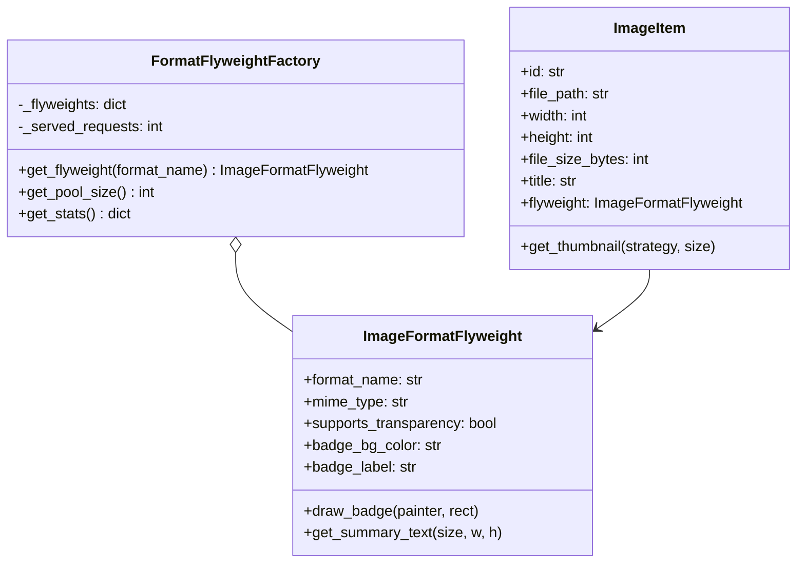
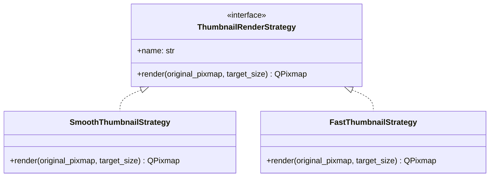
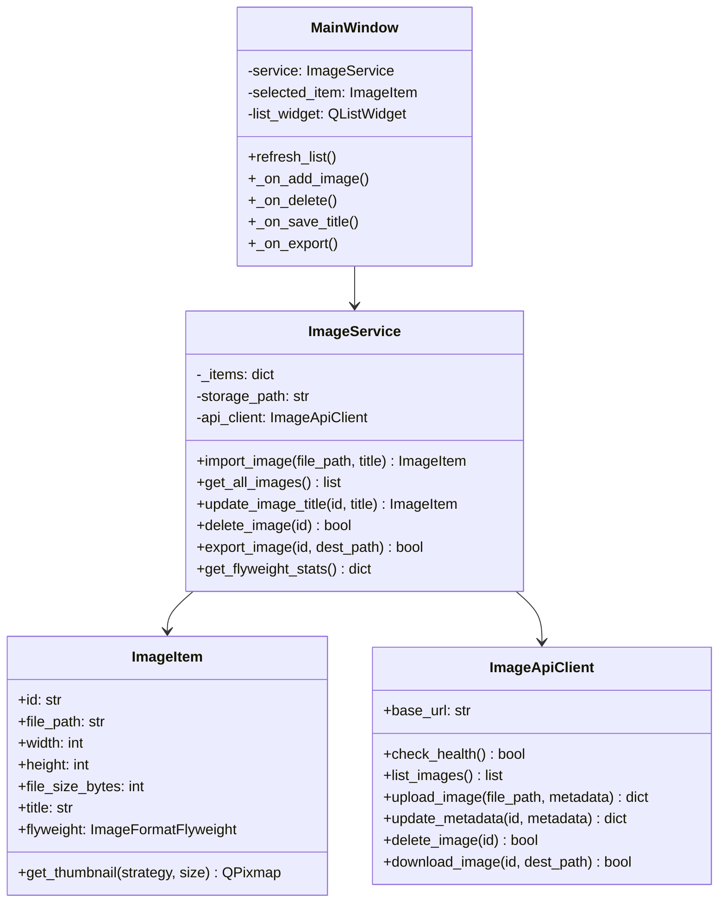

# Organizador de Imagens (Projeto 10)

Disciplina: Paradigmas de Programação  
Turma: CC5AN  
Professor: Alex Carneiro  
Modulo: Cliente Desktop QT (PyQt6) e Servidor Flask (server/)

---

## 1. Visao Geral do Projeto

O Organizador de Imagens e uma aplicacao desktop desenvolvida em Python e PyQt6 com foco na demonstracao dos padroes de projeto solicitados (Abstract Factory, Flyweight e Strategy).

A aplicacao possui uma interface simples com visual nativo contendo uma listagem com operacoes de CRUD direto na tela principal (adicionar imagem, visualizar miniatura e metadados, editar nome, excluir e exportar copia).

---

## 2. Design Patterns Implementados

### Criacional - Abstract Factory
Cria familias compativeis de leitores e geradores de miniaturas para os formatos suportados (JPEG, PNG e BMP).
- Fabrica Abstrata: `ImageFormatFactory`
- Fabricas Concretas: `JPEGFormatFactory`, `PNGFormatFactory`, `BMPFormatFactory`
- Produtos Abstratos: `ImageReader` e `ThumbnailGenerator`
- Seletor de Fabrica: `ImageFormatFactorySelector`


---

### Estrutural - Flyweight
Compartilha metadados e recursos comuns de formato entre as imagens na memoria.
- Estado Intrinseco (`ImageFormatFlyweight`): formato, MIME type, suporte a canal alfa, cores e rotulo do badge.
- Estado Extrinseco (`ImageItem`): caminho, dimensoes, tamanho em bytes e nome.
- Fabrica Flyweight (`FormatFlyweightFactory`): mantem pool unico de formatos e metadados compartilhados.



---

### Comportamental - Strategy
Permite a troca de algoritmos de geracao de miniaturas (conforme a orientacao: "Strategy: trocar algoritmo de ordenacao, filtro ou geracao de miniaturas").
- Estrategia Base: `ThumbnailRenderStrategy`
- Algoritmos Concretos:
  - `SmoothThumbnailStrategy` (Alta qualidade com antialiasing)
  - `FastThumbnailStrategy` (Renderizacao rapida)



---

## 3. Diagrama de Classes do Cliente QT



---

## 4. Requisitos do Sistema

### Requisitos Funcionais (RF)
- RF01 - Adicionar Imagem (Create): Selecao e cadastro de imagens locais nos formatos JPEG, PNG e BMP.
- RF02 - Listar e Visualizar (Read): Listagem direta com QListWidget e painel lateral com miniatura e dados tecnicos.
- RF03 - Editar Nome (Update): Alteracao direta do nome da imagem selecionada.
- RF04 - Excluir (Delete): Remocao da imagem do catalogo com confirmacao.
- RF05 - Exportar (Download): Salvar copia do arquivo no caminho escolhido pelo usuario.
- RF06 - Troca de Algoritmo de Miniatura (Strategy): Selecao entre modo rapido e alta qualidade.
- RF07 - Validacao de Arquivo: Rejeicao de formatos invalidos, arquivos corrompidos ou caminhos inexistentes.

### Requisitos Nao-Funcionais (RNF)
- RNF01 - Sem banco de dados externo ou APIs de terceiros (armazenamento JSON simples).
- RNF02 - Desacoplamento estrutural conforme padroes GoF (Abstract Factory, Flyweight, Strategy).
- RNF03 - Interface desktop simples e nativa em PyQt6.
- RNF04 - Testabilidade automatizada via pytest.

---

## 5. Cenarios de Teste

| Teste | Nome | Acao | Resultado Esperado | Status |
|---|---|---|---|---|
| T10.1 | Importar e visualizar imagens | Importar imagens PNG e JPEG validas | Imagens listadas, miniaturas exibidas, metadados persistidos | Aprovado |
| T10.2 | Arquivo invalido e caminho ausente | Tentar importar arquivo .txt, corrompido ou inexistente | Erro tratado graciosamente, sem travar o QT e sem gravar dados invalidos | Aprovado |
| T10.3 | Upload, metadados e download | Editar nome e exportar copia da imagem | Nome persistido e copia exportada identica ao original | Aprovado |
| T10.4 | Flyweight e Strategy | Importar imagens e alternar modo de miniatura | Reuso de instancias Flyweight comprovado e geracao de miniatura via Strategy | Aprovado |

---

## 6. Instrucoes de Execucao

### Instalacao de dependencias
```bash
pip install -r requirements.txt
```

### Executar o Cliente QT
```bash
python main.py
```

### Executar os Testes Automatizados
```bash
pytest -v
```

### Executar o Servidor Flask (Opcional)
```bash
python server/app.py
```
