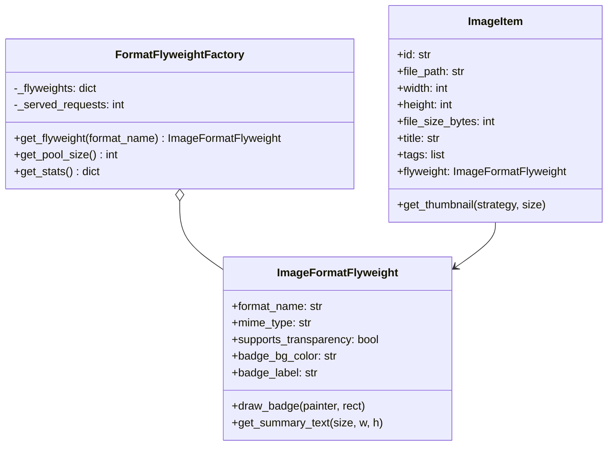
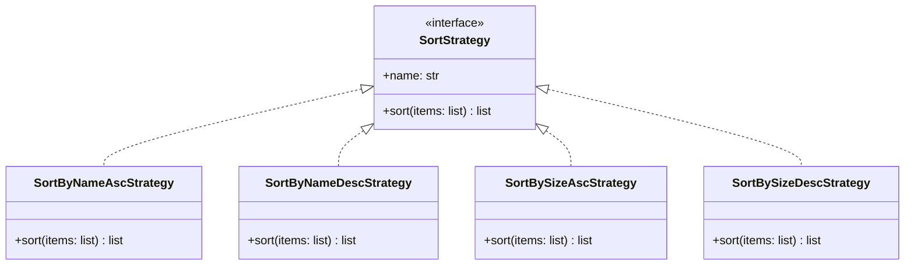
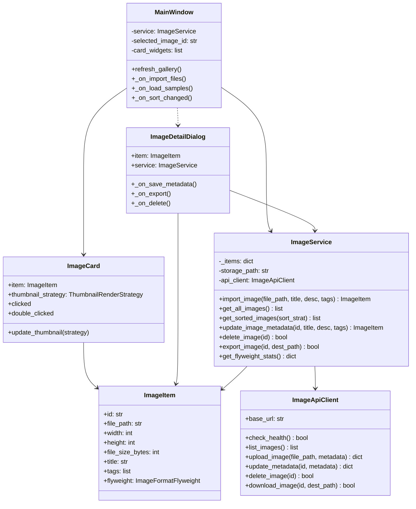

# Organizador de Imagens (Projeto 10)

Disciplina: Paradigmas de Programação  
Turma: CC5AN  
Professor: Alex Carneiro  
Modulo: Cliente Desktop QT (PyQt6) e Servidor Flask (server/)

---

## 1. Visao Geral do Projeto

O Organizador de Imagens e uma aplicacao desktop desenvolvida em Python e PyQt6 com foco na demonstracao dos padroes de projeto solicitados (Abstract Factory, Flyweight e Strategy).

O sistema oferece um CRUD simples de imagens e metadados, suporte aos formatos JPEG, PNG e BMP, persistencia em formato JSON (sem banco de dados externo ou APIs de terceiros) e comunicacao desacoplada para o servidor Flask.

---

## 2. Design Patterns Implementados

### Criacional - Abstract Factory
Cria familias compativeis de leitores e geradores de miniaturas para os formatos suportados.
- Fabrica Abstrata: `ImageFormatFactory`
- Fabricas Concretas: `JPEGFormatFactory`, `PNGFormatFactory`, `BMPFormatFactory`
- Produtos Abstratos: `ImageReader` e `ThumbnailGenerator`
- Seletor de Fabrica: `ImageFormatFactorySelector`


---

### Estrutural - Flyweight
Compartilha metadados e recursos comuns de cada formato entre as miniaturas para economia de memoria.
- Estado Intrinseco (`ImageFormatFlyweight`): formato, MIME type, suporte a canal alfa, cores e rotulo do badge.
- Estado Extrinseco (`ImageItem`): caminho, dimensoes, tamanho em bytes, titulo, tags, descricao.
- Fabrica Flyweight (`FormatFlyweightFactory`): mantem pool unico de formatos e metadados compartilhados.
- Observabilidade: comprovada via `FlyweightStatsWidget` e inspecao de enderecos de memoria.



---

### Comportamental - Strategy
Permite a troca de algoritmos de ordenacao e geracao de miniaturas.
- Estrategias de Ordenacao (`SortStrategy`):
  - `SortByNameAscStrategy` (Nome A-Z)
  - `SortByNameDescStrategy` (Nome Z-A)
  - `SortBySizeAscStrategy` (Tamanho menor primeiro)
  - `SortBySizeDescStrategy` (Tamanho maior primeiro)
- Estrategias de Miniatura (`ThumbnailRenderStrategy`):
  - `SmoothThumbnailStrategy` (Alta qualidade)
  - `FastThumbnailStrategy` (Rapida)



---

## 3. Diagrama de Classes do Cliente QT



---

## 4. Requisitos do Sistema

### Requisitos Funcionais (RF)
- RF01 - Importar Imagem (Create): Selecao e cadastro de imagens locais nos formatos JPEG, PNG e BMP.
- RF02 - Visualizar Galeria (Read): Exibicao em grade com miniatura, dimensoes e tamanho.
- RF03 - Detalhes e Edicao (Update): Visualizacao da imagem e edicao de titulo, tags e descricao.
- RF04 - Exclusao (Delete): Remocao de imagem do catalogo com confirmacao.
- RF05 - Exportacao (Download): Salvar copia do arquivo no caminho escolhido pelo usuario.
- RF06 - Ordenacao (Strategy): Troca de ordenacao por Nome (A-Z / Z-A) ou Tamanho (crescente / decrescente).
- RF07 - Validacao de Arquivo: Rejeicao segura de arquivos corrompidos, formatos invalidos ou caminhos inexistentes.

### Requisitos Nao-Funcionais (RNF)
- RNF01 - Sem banco de dados externo ou APIs de terceiros (armazenamento JSON simples).
- RNF02 - Desacoplamento estrutural conforme padroes GoF (Abstract Factory, Flyweight, Strategy).
- RNF03 - Interface desktop desenvolvida em PyQt6.
- RNF04 - Testabilidade automatizada via pytest.

---

## 5. Cenarios de Teste

| Teste | Nome | Acao | Resultado Esperado | Status |
|---|---|---|---|---|
| T10.1 | Importar e visualizar imagens | Importar imagens PNG e JPEG validas | Imagens catalogadas, miniaturas exibidas, metadados persistidos | Aprovado |
| T10.2 | Arquivo invalido e caminho ausente | Tentar importar arquivo .txt, corrompido ou inexistente | Erro tratado graciosamente, sem travar o QT e sem gravar dados invalidos | Aprovado |
| T10.3 | Upload, metadados e download | Editar metadados e exportar copia da imagem | Metadados persistidos e copia exportada identica ao original | Aprovado |
| T10.4 | Flyweight e Strategy | Importar imagens e alternar ordenacao | Reuso de instancias Flyweight comprovado e lista reordenada via Strategy | Aprovado |

---

## 6. Instrucoes de Execucao

### Instalacao de dependencias
```bash
pip install -r requirements.txt
```

### Executar o Cliente QT
```bash
python main.py
```

### Executar os Testes Automatizados
```bash
pytest -v
```

### Executar o Servidor Flask (Opcional)
```bash
python server/app.py
```
