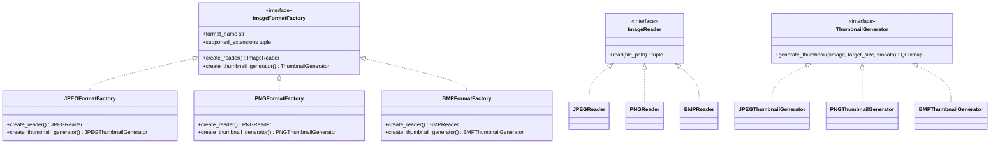
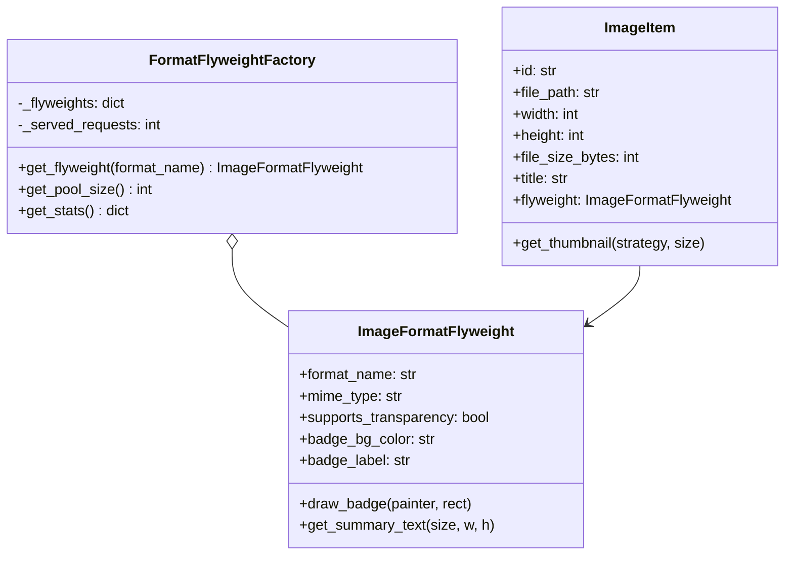
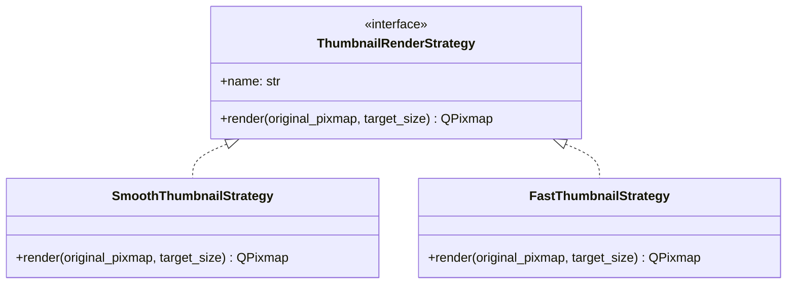
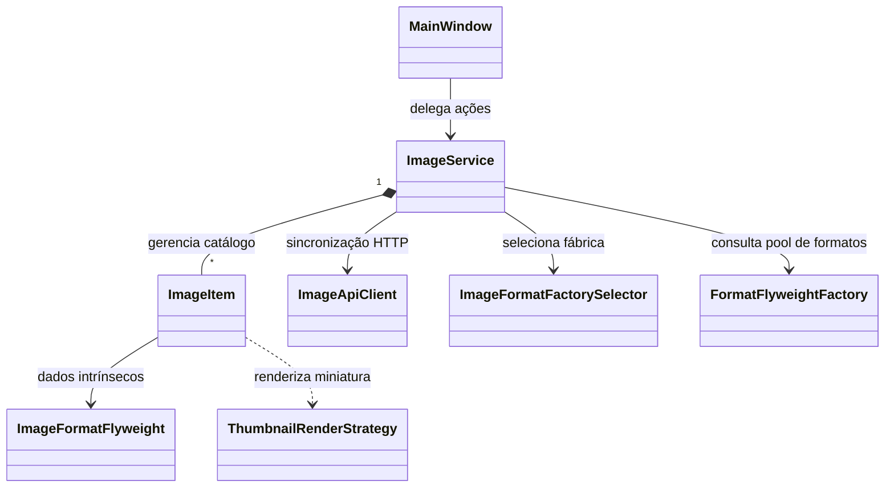
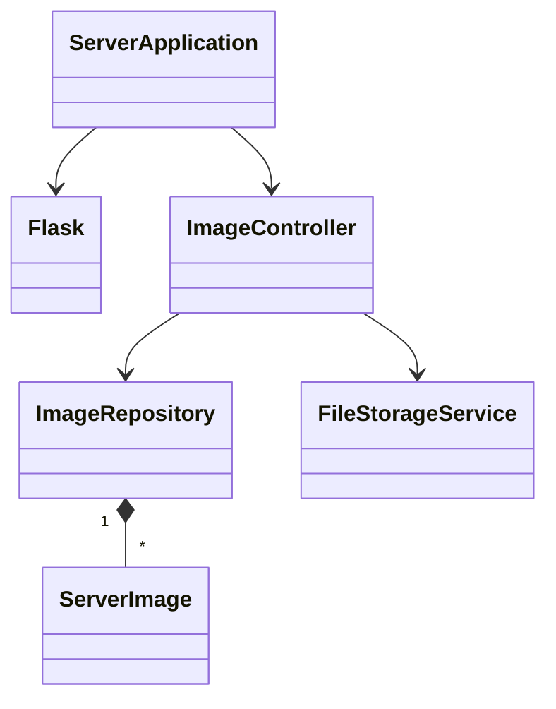

# Organizador de Imagens (Projeto 10)

[](https://www.python.org/)
[](https://riverbankcomputing.com/software/pyqt/)
[](https://palletsprojects.com/p/flask/)
[](#2-design-patterns-implementados)

**Disciplina:** Paradigmas de Programação  
**Turma:** CC5AN  
**Professor:** Alex Carneiro  
**Módulos:** Cliente Desktop Qt (PyQt6) e Servidor Web Flask (`server/`)  

---

## 📑 Documentação Formal do Projeto

Para atender rigorosamente aos critérios de entrega e avaliação da disciplina, a documentação técnica foi estruturada e disponibilizada em arquivos dedicados na pasta [`docs/`](docs/):

| Documento | Descrição do Conteúdo | Link Direto |
|---|---|---|
| **Documentação Completa** | Documento consolidado unificado com todas as seções para leitura corrida ou exportação. | [`docs/DOCUMENTACAO_COMPLETA.md`](docs/DOCUMENTACAO_COMPLETA.md) |
| **Diagrama de Classes — Cliente** | Modelagem UML completa do cliente PyQt6 (UI, Services, Models, Patterns e API Client). | [`docs/01-diagrama-classes-cliente.md`](docs/01-diagrama-classes-cliente.md) |
| **Diagrama de Classes — Servidor** | Modelagem UML e arquitetural do servidor backend Flask, controladores, repositórios e endpoints REST. | [`docs/02-diagrama-classes-servidor.md`](docs/02-diagrama-classes-servidor.md) |
| **Requisitos do Sistema** | Requisitos Funcionais (RF01 a RF15), Não-Funcionais (RNF01 a RNF08), Regras de Negócio e MoSCoW. | [`docs/03-requisitos-sistema.md`](docs/03-requisitos-sistema.md) |
| **Condições de Aceitação** | Critérios de Aceite formais em BDD / Gherkin (*Dado que / Quando / Então*) e matriz de rastreabilidade. | [`docs/04-condicoes-aceitacao.md`](docs/04-condicoes-aceitacao.md) |

---

## 1. Visão Geral do Projeto

O **Organizador de Imagens** é uma aplicação desktop desenvolvida em Python e PyQt6 com persistência leve e sincronização remota opcional com um servidor Flask. O projeto foi projetado para demonstrar os padrões de projeto solicitados:
1. **Abstract Factory** (Criacional): Fabricação de leitores e geradores de miniaturas específicos por formato de imagem (JPEG, PNG e BMP).
2. **Flyweight** (Estrutural): Compartilhamento em memória de metadados imutáveis e configurações de formato.
3. **Strategy** (Comportamental): Troca dinâmica em tempo de execução dos algoritmos de renderização de miniaturas (Alta Qualidade vs Rápida).

---

## 2. Design Patterns Implementados

### 2.1 Criacional — Abstract Factory
Cria famílias compatíveis de leitores e geradores de miniaturas para os formatos suportados (JPEG, PNG e BMP):
- **Fábrica Abstrata:** `ImageFormatFactory`
- **Fábricas Concretas:** `JPEGFormatFactory`, `PNGFormatFactory`, `BMPFormatFactory`
- **Produtos Abstratos:** `ImageReader` e `ThumbnailGenerator`
- **Seletor Dinâmico de Fábrica:** `ImageFormatFactorySelector`



---

### 2.2 Estrutural — Flyweight
Compartilha metadados intrínsecos comuns de formato entre todas as imagens cadastradas na memória:
- **Estado Intrínseco (`ImageFormatFlyweight`):** Formato, MIME type, suporte a canal alfa, esquema de cores e rótulo do crachá.
- **Estado Extrínseco (`ImageItem`):** Caminho em disco, largura, altura, tamanho em bytes e nome/título.
- **Fábrica Flyweight (`FormatFlyweightFactory`):** Singleton que gerencia o pool único de formatos e expõe contadores de instâncias salvas.



---

### 2.3 Comportamental — Strategy
Permite a troca em tempo de execução dos algoritmos de renderização de miniaturas:
- **Estratégia Base:** `ThumbnailRenderStrategy`
- **Algoritmos Concretos:**
  - `SmoothThumbnailStrategy` (Alta qualidade com interpolação suave / antialiasing)
  - `FastThumbnailStrategy` (Renderização rápida por vizinho mais próximo)



---

## 3. Arquitetura do Sistema e Diagramas de Classes

### 3.1 Diagrama de Classes do Cliente Desktop
Consulte o arquivo dedicado com a modelagem completa: [`docs/01-diagrama-classes-cliente.md`](docs/01-diagrama-classes-cliente.md).



### 3.2 Diagrama de Classes e Arquitetura do Servidor Flask
Consulte o arquivo dedicado com a modelagem completa: [`docs/02-diagrama-classes-servidor.md`](docs/02-diagrama-classes-servidor.md).



---

## 4. Requisitos do Sistema (Resumo)

### Requisitos Funcionais (RF)
- **RF01 a RF03**: Seleção, validação rigorosa de formatos e extração automática de metadados.
- **RF04 e RF05**: Listagem dinâmica de imagens e painel técnico com miniatura e detalhes.
- **RF06 a RF08**: CRUD com edição de nome, exclusão confirmada e exportação de cópias.
- **RF09 a RF11**: Alternância de algoritmos Strategy, pool Flyweight com contador e carga de exemplos em lote.
- **RF12 a RF15**: Persistência local em JSON, monitoramento de saúde da API (`/api/health`) e sincronização remota com download de arquivos.

### Requisitos Não-Funcionais (RNF)
- **RNF01**: Implementação dos 3 padrões GoF (Abstract Factory, Flyweight e Strategy).
- **RNF02**: Arquitetura modular desacoplada em pacotes (`ui`, `services`, `models`, `patterns`).
- **RNF03**: Operação resiliente com suporte total ao modo offline (*Offline First*).
- **RNF04**: Timeout estrito de 2,0s em requisições de rede para evitar travamento da interface.
- **RNF05**: Persistência leve e portátil baseada em JSON, dispensando SGBD externo.
- **RNF06**: Tratamento seguro de upload com `secure_filename` e isolamento por UUID.

*Consulte a especificação completa com tabela MoSCoW em [`docs/03-requisitos-sistema.md`](docs/03-requisitos-sistema.md).*

---

## 5. Condições de Aceitação (Resumo)

Todos os fluxos foram formalizados segundo a metodologia **BDD / Gherkin** (*Dado que... Quando... Então...*), cobrindo:
- Cenários de importação de arquivos válidos e rejeição amigável de extensões não suportadas ou binários corrompidos.
- Validação visual e de integridade ao trocar estratégias de renderização de miniatura.
- Testes de isolamento e tolerância a falhas na ausência do servidor backend.
- Validação de endpoints da API REST (`GET`, `POST`, `PUT`, `DELETE` e download de arquivo).

*Consulte todos os 21 cenários de aceitação em [`docs/04-condicoes-aceitacao.md`](docs/04-condicoes-aceitacao.md).*

---

## 6. Instruções de Execução

### 6.1 Instalação de Dependências
Recomenda-se a utilização de um ambiente virtual Python:
```bash
python -m venv venv
# No Windows:
.\venv\Scripts\activate
# No Linux/Mac:
source venv/bin/activate

pip install -r requirements.txt
```

### 6.2 Execução do Servidor Flask (Opcional)
```bash
python server/app.py
```
O servidor iniciará escutando em `http://127.0.0.1:5000`.

### 6.3 Execução do Cliente Desktop Qt
Em uma nova janela de terminal:
```bash
python main.py
```

---

## 7. Estrutura de Diretórios do Repositório

```text
organizador-imagens/
├── client/
│   ├── models/
│   │   └── image_item.py          # Modelo de dados e cache de miniaturas
│   ├── patterns/
│   │   ├── abstract_factory.py    # Abstract Factory (leitores e geradores)
│   │   ├── flyweight.py           # Flyweight (metadados e badges)
│   │   └── strategy.py            # Strategy (renderização de miniaturas)
│   ├── services/
│   │   ├── api_client.py          # Cliente HTTP para API Flask
│   │   └── image_service.py       # Regras de negócio e catálogo local
│   └── ui/
│       └── main_window.py         # Interface gráfica PyQt6
├── data/
│   └── catalog.json               # Persistência local do cliente
├── docs/
│   ├── 01-diagrama-classes-cliente.md
│   ├── 02-diagrama-classes-servidor.md
│   ├── 03-requisitos-sistema.md
│   ├── 04-condicoes-aceitacao.md
│   └── DOCUMENTACAO_COMPLETA.md   # Documento unificado consolidado
├── sample_images/                 # Amostras para teste e validação
├── server/
│   ├── app.py                     # API RESTful Flask
│   ├── data/                      # Catálogo do servidor
│   └── uploads/                   # Armazenamento de arquivos binários
├── main.py                        # Ponto de entrada da aplicação cliente
├── README.md                      # Apresentação do projeto e índice
└── requirements.txt               # Dependências do projeto
```
