# Diagrama de Classes — Cliente Desktop (PyQt6)

Este documento apresenta a modelagem orientada a objetos da aplicação cliente desktop (**Organizador de Imagens**), desenvolvida em Python e PyQt6, destacando a aplicação dos padrões de projeto GoF (**Abstract Factory**, **Flyweight** e **Strategy**), a arquitetura em camadas e o tratamento de persistência e comunicação remota.

---

## 1. Diagrama Geral de Classes do Cliente (Mermaid)

```mermaid
classDiagram
    direction TB

    %% Camada de Apresentação (UI)
    class MainWindow {
        -ImageService service
        -ImageItem selected_item
        -QListWidget list_widget
        -QLabel lbl_preview
        -QLabel lbl_format
        -QLabel lbl_dims
        -QLabel lbl_size
        -QLabel lbl_flyweight_status
        -QLineEdit edit_title
        -QPushButton btn_add
        -QPushButton btn_samples
        -QPushButton btn_delete
        -QPushButton btn_export
        -QPushButton btn_save_title
        -QComboBox combo_strategy
        -List~ThumbnailRenderStrategy~ strategies
        +__init__(service: ImageService)
        +refresh_list() void
        -_setup_ui() void
        -_on_row_changed(row: int) void
        -_update_preview() void
        -_on_strategy_changed() void
        -_on_add_image() void
        -_on_load_samples() void
        -_on_save_title() void
        -_on_delete() void
        -_on_export() void
    }

    %% Camada de Serviço
    class ImageService {
        -str storage_path
        -dict _items
        -ImageApiClient api_client
        -FormatFlyweightFactory flyweight_factory
        -ThumbnailRenderStrategy active_thumbnail_strategy
        +__init__(storage_path: str, api_client: ImageApiClient)
        +import_image(file_path: str, title: str) ImageItem
        +get_all_images() List~ImageItem~
        +get_image_by_id(image_id: str) ImageItem
        +update_image_title(image_id: str, title: str) ImageItem
        +delete_image(image_id: str) bool
        +export_image(image_id: str, destination_path: str) bool
        +get_flyweight_stats() dict
        -_save_to_storage() void
        -_load_from_storage() void
    }

    %% Camada de Modelo
    class ImageItem {
        +str id
        +str file_path
        +str file_name
        +int width
        +int height
        +int file_size_bytes
        +str title
        +ImageFormatFlyweight flyweight
        -QPixmap _cached_thumbnail
        -str _cached_strategy_name
        +__init__(file_path, width, height, file_size_bytes, format_name, title, image_id)
        +format_name() str
        +dimensions_text() str
        +size_formatted() str
        +load_full_pixmap() QPixmap
        +get_thumbnail(strategy: ThumbnailRenderStrategy, target_size: QSize) QPixmap
        +to_dict() dict
        +from_dict(data: dict)$ ImageItem
    }

    %% Camada de Comunicação com Backend
    class ImageApiClient {
        -str base_url
        -float timeout
        -bool _is_online
        +__init__(base_url: str, timeout_seconds: float)
        +is_online() bool
        +check_health() bool
        +list_images() List~dict~
        +upload_image(file_path: str, metadata: dict) dict
        +update_metadata(image_id: str, metadata: dict) dict
        +delete_image(image_id: str) bool
        +download_image(image_id: str, destination_path: str) bool
    }

    class ApiConnectionError {
        <<exception>>
    }

    %% Padrão Abstract Factory
    class ImageFormatFactorySelector {
        -List~ImageFormatFactory~ _factories$
        +get_factory_for_file(file_path: str)$ ImageFormatFactory
        +get_factory_for_extension(extension: str)$ ImageFormatFactory
        +get_factory_for_format(format_name: str)$ ImageFormatFactory
        +get_all_supported_extensions()$ List~str~
    }

    class ImageFormatFactory {
        <<abstract>>
        +create_reader()* ImageReader
        +create_thumbnail_generator()* ThumbnailGenerator
        +format_name()* str
        +supported_extensions()* Tuple~str~
    }

    class JPEGFormatFactory {
        +create_reader() ImageReader
        +create_thumbnail_generator() ThumbnailGenerator
        +format_name() str
        +supported_extensions() Tuple~str~
    }

    class PNGFormatFactory {
        +create_reader() ImageReader
        +create_thumbnail_generator() ThumbnailGenerator
        +format_name() str
        +supported_extensions() Tuple~str~
    }

    class BMPFormatFactory {
        +create_reader() ImageReader
        +create_thumbnail_generator() ThumbnailGenerator
        +format_name() str
        +supported_extensions() Tuple~str~
    }

    class ImageReader {
        <<abstract>>
        +read(file_path: str)* tuple
    }

    class JPEGReader {
        +read(file_path: str) tuple
    }

    class PNGReader {
        +read(file_path: str) tuple
    }

    class BMPReader {
        +read(file_path: str) tuple
    }

    class ThumbnailGenerator {
        <<abstract>>
        +generate_thumbnail(qimage: QImage, target_size: QSize, smooth: bool)* QPixmap
    }

    class JPEGThumbnailGenerator {
        +generate_thumbnail(qimage: QImage, target_size: QSize, smooth: bool) QPixmap
    }

    class PNGThumbnailGenerator {
        +generate_thumbnail(qimage: QImage, target_size: QSize, smooth: bool) QPixmap
    }

    class BMPThumbnailGenerator {
        +generate_thumbnail(qimage: QImage, target_size: QSize, smooth: bool) QPixmap
    }

    class UnsupportedFormatException {
        <<exception>>
    }

    class InvalidImageFileException {
        <<exception>>
    }

    %% Padrão Strategy
    class ThumbnailRenderStrategy {
        <<abstract>>
        +name()* str
        +render(original_pixmap: QPixmap, target_size: QSize)* QPixmap
    }

    class SmoothThumbnailStrategy {
        +name() str
        +render(original_pixmap: QPixmap, target_size: QSize) QPixmap
    }

    class FastThumbnailStrategy {
        +name() str
        +render(original_pixmap: QPixmap, target_size: QSize) QPixmap
    }

    %% Padrão Flyweight
    class FormatFlyweightFactory {
        -FormatFlyweightFactory _instance$
        -dict _flyweights
        -int _served_requests
        +__new__() FormatFlyweightFactory
        -_initialize_default_flyweights() void
        +get_flyweight(format_name: str) ImageFormatFlyweight
        +get_pool_size() int
        +get_served_requests_count() int
        +get_stats(total_images: int, unique_formats_count: int) dict
    }

    class ImageFormatFlyweight {
        <<dataclass frozen>>
        +str format_name
        +str mime_type
        +bool supports_transparency
        +str default_extension
        +str badge_bg_color
        +str badge_text_color
        +str badge_label
        +str description
        +get_summary_text(extrinsic_size_bytes: int, width: int, height: int) str
        +draw_badge(painter: QPainter, rect: QRect) void
    }

    %% Relacionamentos Estruturais
    MainWindow --> ImageService : delega operações
    MainWindow ..> ImageItem : exibe e manipula seleção
    MainWindow ..> ThumbnailRenderStrategy : aplica estratégia selecionada

    ImageService "1" *-- "*" ImageItem : gerencia catálogo em memória
    ImageService --> ImageApiClient : sincronização remota
    ImageService --> ImageFormatFactorySelector : obtém fábrica por arquivo
    ImageService --> FormatFlyweightFactory : acessa fábrica de flyweights
    ImageService ..> ThumbnailRenderStrategy : mantém estratégia ativa

    ImageItem --> ImageFormatFlyweight : referencia estado intrínseco
    ImageItem ..> ThumbnailRenderStrategy : utiliza na geração de preview

    ImageApiClient ..> ApiConnectionError : lança em falhas HTTP

    ImageFormatFactorySelector ..> ImageFormatFactory : cria e gerencia instâncias
    ImageFormatFactorySelector ..> UnsupportedFormatException : lança

    ImageFormatFactory <|-- JPEGFormatFactory : herda de
    ImageFormatFactory <|-- PNGFormatFactory : herda de
    ImageFormatFactory <|-- BMPFormatFactory : herda de

    ImageReader <|-- JPEGReader : herda de
    ImageReader <|-- PNGReader : herda de
    ImageReader <|-- BMPReader : herda de

    ThumbnailGenerator <|-- JPEGThumbnailGenerator : herda de
    ThumbnailGenerator <|-- PNGThumbnailGenerator : herda de
    ThumbnailGenerator <|-- BMPThumbnailGenerator : herda de

    JPEGFormatFactory ..> JPEGReader : instancia
    JPEGFormatFactory ..> JPEGThumbnailGenerator : instancia
    PNGFormatFactory ..> PNGReader : instancia
    PNGFormatFactory ..> PNGThumbnailGenerator : instancia
    BMPFormatFactory ..> BMPReader : instancia
    BMPFormatFactory ..> BMPThumbnailGenerator : instancia

    ImageReader ..> InvalidImageFileException : valida integridade do arquivo

    ThumbnailRenderStrategy <|-- SmoothThumbnailStrategy : herda de
    ThumbnailRenderStrategy <|-- FastThumbnailStrategy : herda de

    FormatFlyweightFactory "1" o-- "*" ImageFormatFlyweight : armazena e compartilha instâncias
```

---

## 2. Detalhamento dos Componentes do Cliente

### 2.1 Interface Gráfica e Apresentação (`client/ui/main_window.py`)
- **`MainWindow`**: Janela principal construída com PyQt6.
  - Divide a interface através de um `QSplitter` horizontal entre a listagem de imagens (`QListWidget`) e o painel de detalhes/visualização.
  - Implementa botões de ação: Adicionar Imagem, Carregar Exemplos, Salvar Nome, Excluir Imagem e Exportar Cópia.
  - Conecta a seleção do usuário à renderização dinâmica de miniaturas e informações técnicas (dimensões, tamanho formatado e badge do formato).
  - Exibe na barra inferior o contador de instâncias economizadas pelo padrão Flyweight.

### 2.2 Camada de Negócios e Serviços (`client/services/image_service.py`)
- **`ImageService`**: Controlador central de regras de negócio do cliente.
  - **CRUD Completo**: `import_image`, `get_all_images`, `update_image_title`, `delete_image` e `export_image`.
  - **Persistência Local**: Serializa e desserializa o catálogo de imagens em `data/catalog.json` de forma transparente.
  - **Resiliência e Modo Offline**: Antes de qualquer requisição de rede, valida a saúde do backend (`api_client.check_health()`). Caso o servidor esteja inacessível, as operações locais de importação, edição e exclusão são concluídas normalmente sem travar a interface.

### 2.3 Camada de Domínio (`client/models/image_item.py`)
- **`ImageItem`**: Representa uma entidade de imagem no cliente.
  - **Separação de Estados (Flyweight)**:
    - *Estado Extrínseco (específico de cada arquivo)*: `id`, `file_path`, `file_name`, `width`, `height`, `file_size_bytes`, `title`.
    - *Estado Intrínseco (compartilhado)*: Referência imutável para `ImageFormatFlyweight`.
  - **Cache de Miniatura**: Mantém em `_cached_thumbnail` a miniatura renderizada para evitar reprocessamento desnecessário enquanto a estratégia e o arquivo não sofrerem alterações.

### 2.4 Camada de Comunicação com a API (`client/services/api_client.py`)
- **`ImageApiClient`**: Cliente HTTP baseado na biblioteca `requests`.
  - Timeout estrito de 2.0 segundos para evitar travamento da interface síncrona.
  - Trata exceções com classe dedicada `ApiConnectionError`.
  - Endpoints consumidos: `/api/health`, `/api/images` (GET, POST, PUT, DELETE) e `/api/images/<id>/file` (Download).

---

## 3. Padrões de Projeto (GoF) Implementados

### 3.1 Padrão Criacional: Abstract Factory (`client/patterns/abstract_factory.py`)
- **Objetivo**: Fornecer uma interface para criar famílias de objetos relacionados (leitor e gerador de miniatura específico) sem especificar suas classes concretas.
- **Participantes**:
  - `ImageFormatFactory` (Fábrica Abstrata).
  - `JPEGFormatFactory`, `PNGFormatFactory`, `BMPFormatFactory` (Fábricas Concretas).
  - `ImageReader` e `ThumbnailGenerator` (Produtos Abstratos).
  - `JPEGReader`, `PNGReader`, `BMPReader`, `JPEGThumbnailGenerator`, `PNGThumbnailGenerator`, `BMPThumbnailGenerator` (Produtos Concretos).
  - `ImageFormatFactorySelector`: Ponto de entrada estático que roteia a extensão do arquivo (`.jpg`, `.png`, `.bmp`) para a fábrica adequada.

### 3.2 Padrão Estrutural: Flyweight (`client/patterns/flyweight.py`)
- **Objetivo**: Reduzir o consumo de memória compartilhando com eficácia dados comuns entre múltiplos objetos similares.
- **Participantes**:
  - `ImageFormatFlyweight`: Dataclass congelada (`frozen=True`) contendo propriedades invariantes de formato (nome MIME, canal alfa, cores de renderização de crachá e descrição).
  - `FormatFlyweightFactory`: Singleton responsável por manter o pool de formatos (`JPEG`, `PNG`, `BMP`) e monitorar estatísticas de referências atendidas e instâncias salvas.

### 3.3 Padrão Comportamental: Strategy (`client/patterns/strategy.py`)
- **Objetivo**: Definir uma família de algoritmos, encapsulá-los e torná-los intercambiáveis em tempo de execução.
- **Participantes**:
  - `ThumbnailRenderStrategy`: Interface abstrata com o método `render(original_pixmap, target_size)`.
  - `SmoothThumbnailStrategy`: Implementa escalonamento bilinear de alta fidelidade visual (`Qt.TransformationMode.SmoothTransformation`).
  - `FastThumbnailStrategy`: Implementa escalonamento rápido por vizinho mais próximo (`Qt.TransformationMode.FastTransformation`), ideal para alta performance ou grandes volumes.
