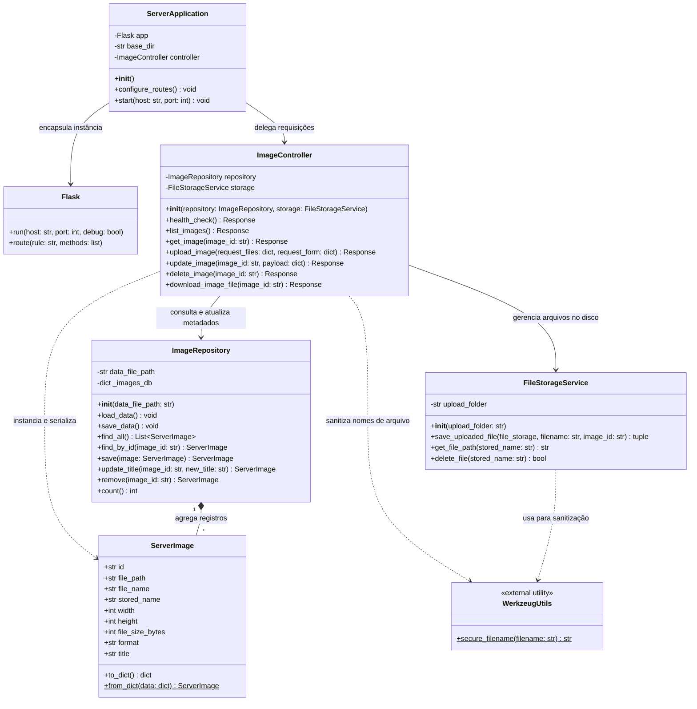

# Diagrama de Classes e Arquitetura do Servidor Backend (Flask)

Este documento detalha a arquitetura, o diagrama de classes e o contrato de interface da API do módulo **Servidor Backend** do sistema **Organizador de Imagens**, implementado em Python utilizando o microframework Flask.

---

## 1. Visão de Engenharia e Arquitetura do Servidor

No arquivo `server/app.py`, o servidor é estruturado em torno da aplicação Flask com persistência documental em JSON e gerenciamento de arquivos binários no sistema de arquivos local (`server/uploads/`). 

Para fins de modelagem formal em **Engenharia de Software e Orientação a Objetos (UML)**, a estrutura funcional e de dados do servidor é decomposta em quatro responsabilidades canônicas:

1. **Camada de Aplicação e Roteamento (`ServerApplication` / `ImageController`)**: Gerencia o ciclo de vida do servidor HTTP, registra as rotas e serializa/desserializa os payloads HTTP (JSON e `multipart/form-data`).
2. **Camada de Repositório e Persistência (`ImageRepository`)**: Gerencia a coleção em memória (`images_db`), leitura e escrita atômica no arquivo físico `server_catalog.json`.
3. **Camada de Armazenamento de Arquivos (`FileStorageService`)**: Trata a gravação de arquivos com nomenclatura segura (`secure_filename`), vinculação a identificadores únicos UUIDv4 e exclusão de binários.
4. **Entidade de Domínio (`ServerImage`)**: Representação da estrutura do registro de imagem persistido.

---

## 2. Diagrama de Classes do Servidor (Mermaid)

---

## 3. Especificação do Contrato da API REST (Endpoints)

A tabela a seguir descreve todos os endpoints disponibilizados pelo servidor, métodos HTTP aceitos, parâmetros e códigos de resposta:

| Método | Endpoint | Parâmetros / Payload | Resposta de Sucesso | Códigos HTTP | Descrição e Regras |
|---|---|---|---|---|---|
| `GET` | `/api/health` | Nenhum | JSON com `status`, `service`, `total_images`, `timestamp` | `200 OK` | Health check da API para verificação de conectividade pelo cliente. |
| `GET` | `/api/images` | Nenhum | Array JSON contendo a lista de todas as imagens cadastradas | `200 OK` | Retorna o catálogo completo do servidor. |
| `GET` | `/api/images/<image_id>` | URL: `image_id` (UUID) | Objeto JSON com metadados da imagem selecionada | `200 OK` `404 Not Found` | Busca metadados de uma imagem específica. Retorna 404 se o ID não existir. |
| `POST` | `/api/images` | Form-Data: • `file` (arquivo binário obrigatório) • `title` (string opcional) | Objeto JSON da imagem criada com metadados gerados | `201 Created` `400 Bad Request` | Realiza upload da imagem, gera UUID, armazena no diretório `uploads/` com nome sanitizado e registra no catálogo. |
| `PUT` | `/api/images/<image_id>` | URL: `image_id` JSON Body: `{"title": "Novo Titulo"}` | Objeto JSON atualizado com o novo título | `200 OK` `404 Not Found` | Atualiza o título da imagem. Se omitido ou vazio, reverte para o nome original do arquivo. |
| `DELETE` | `/api/images/<image_id>` | URL: `image_id` (UUID) | JSON `{"success": true}` | `200 OK` `404 Not Found` | Remove o registro do catálogo e exclui o arquivo físico correspondente em `uploads/`. |
| `GET` | `/api/images/<image_id>/file` | URL: `image_id` (UUID) | Fluxo binário do arquivo (download com header `Content-Disposition`) | `200 OK` `404 Not Found` | Realiza o download do arquivo de imagem salvo no servidor. |

---

## 4. Estratégia de Persistência e Isolamento

1. **Catálogo de Metadados (`server/data/server_catalog.json`)**:
   - Os dados são serializados com indentação e formatação UTF-8.
   - Cada imagem é identificada por uma chave primária UUID v4 imutável.
2. **Armazenamento de Binários (`server/uploads/`)**:
   - Para evitar conflitos de arquivos de mesmo nome e ataques de *Directory Traversal*, o servidor prefixa o UUID da imagem ao nome seguro gerado por `secure_filename(filename)`.
   - Exemplo: `9b1deb4d-3b7d-4bad-9bdd-2b0d7b3dcb6d_sunset.jpg`.
