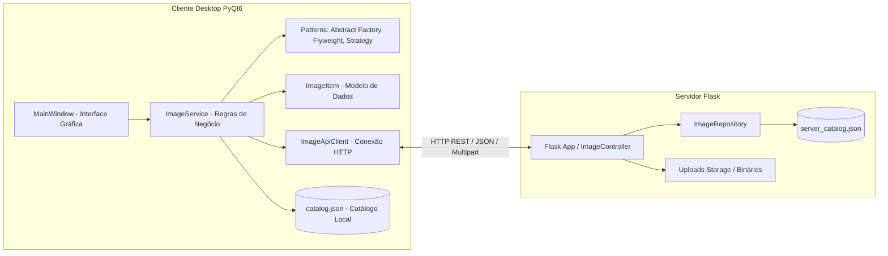
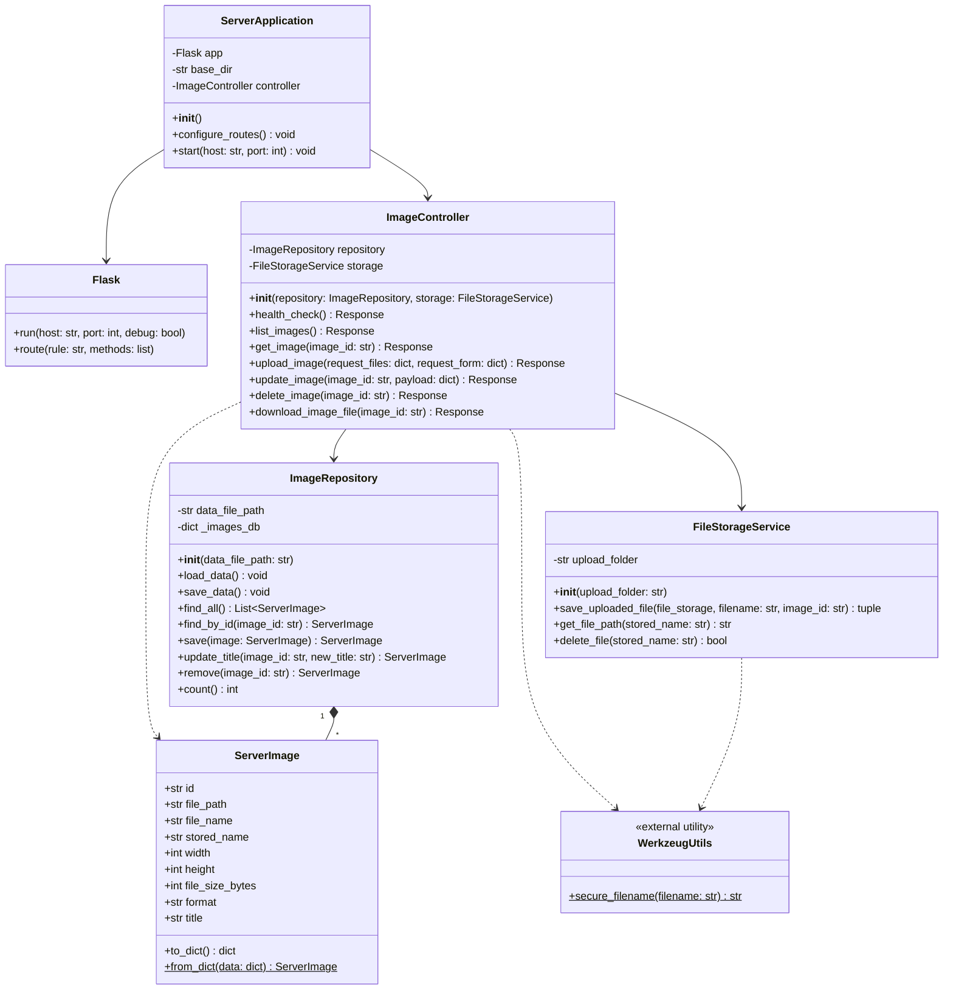

# Documentação Completa do Projeto: Organizador de Imagens

**Disciplina:** Paradigmas de Programação  
**Turma:** CC5AN  
**Professor:** Alex Carneiro  
**Projeto:** Organizador de Imagens (Cliente Desktop PyQt6 & Servidor Backend Flask)  
**Padrões de Projeto (GoF):** Abstract Factory (Criacional), Flyweight (Estrutural) e Strategy (Comportamental)  

---

## Sumário Executivo

- [1. Visão Geral da Arquitetura](#1-visão-geral-da-arquitetura)
- [2. Diagrama de Classes do Cliente](#2-diagrama-de-classes-do-cliente)
- [3. Diagrama de Classes do Servidor](#3-diagrama-de-classes-do-servidor)
- [4. Padrões de Projeto Implementados](#4-padrões-de-projeto-implementados)
- [5. Requisitos Funcionais e Não-Funcionais](#5-requisitos-funcionais-e-não-funcionais)
- [6. Condições de Aceitação (Critérios de Aceite BDD)](#6-condições-de-aceitação-critérios-de-aceite-bdd)
- [7. Guia de Execução e Verificação](#7-guia-de-execução-e-verificação)

---

## 1. Visão Geral da Arquitetura

O **Organizador de Imagens** é uma solução de software distribuída projetada para demonstrar a aplicação prática de três padrões de projeto fundamentais (GoF) em Python, integrando uma aplicação cliente com interface gráfica rica em **PyQt6** e um serviço de retaguarda (*backend*) RESTful baseado em **Flask**.



---

## 2. Diagrama de Classes do Cliente

O diagrama abaixo modela todas as classes, métodos, atributos e relacionamentos da aplicação cliente:

```mermaid
classDiagram
    direction TB

    %% Camada de Apresentação (UI)
    class MainWindow {
        -ImageService service
        -ImageItem selected_item
        -QListWidget list_widget
        -QLabel lbl_preview
        -QLabel lbl_format
        -QLabel lbl_dims
        -QLabel lbl_size
        -QLabel lbl_flyweight_status
        -QLineEdit edit_title
        -QPushButton btn_add
        -QPushButton btn_samples
        -QPushButton btn_delete
        -QPushButton btn_export
        -QPushButton btn_save_title
        -QComboBox combo_strategy
        -List~ThumbnailRenderStrategy~ strategies
        +__init__(service: ImageService)
        +refresh_list() void
        -_setup_ui() void
        -_on_row_changed(row: int) void
        -_update_preview() void
        -_on_strategy_changed() void
        -_on_add_image() void
        -_on_load_samples() void
        -_on_save_title() void
        -_on_delete() void
        -_on_export() void
    }

    %% Camada de Serviço
    class ImageService {
        -str storage_path
        -dict _items
        -ImageApiClient api_client
        -FormatFlyweightFactory flyweight_factory
        -ThumbnailRenderStrategy active_thumbnail_strategy
        +__init__(storage_path: str, api_client: ImageApiClient)
        +import_image(file_path: str, title: str) ImageItem
        +get_all_images() List~ImageItem~
        +get_image_by_id(image_id: str) ImageItem
        +update_image_title(image_id: str, title: str) ImageItem
        +delete_image(image_id: str) bool
        +export_image(image_id: str, destination_path: str) bool
        +get_flyweight_stats() dict
        -_save_to_storage() void
        -_load_from_storage() void
    }

    %% Camada de Modelo
    class ImageItem {
        +str id
        +str file_path
        +str file_name
        +int width
        +int height
        +int file_size_bytes
        +str title
        +ImageFormatFlyweight flyweight
        -QPixmap _cached_thumbnail
        -str _cached_strategy_name
        +__init__(file_path, width, height, file_size_bytes, format_name, title, image_id)
        +format_name() str
        +dimensions_text() str
        +size_formatted() str
        +load_full_pixmap() QPixmap
        +get_thumbnail(strategy: ThumbnailRenderStrategy, target_size: QSize) QPixmap
        +to_dict() dict
        +from_dict(data: dict)$ ImageItem
    }

    %% Camada de Conexão HTTP
    class ImageApiClient {
        -str base_url
        -float timeout
        -bool _is_online
        +__init__(base_url: str, timeout_seconds: float)
        +is_online() bool
        +check_health() bool
        +list_images() List~dict~
        +upload_image(file_path: str, metadata: dict) dict
        +update_metadata(image_id: str, metadata: dict) dict
        +delete_image(image_id: str) bool
        +download_image(image_id: str, destination_path: str) bool
    }

    class ApiConnectionError {
        <<exception>>
    }

    %% Padrão Abstract Factory
    class ImageFormatFactorySelector {
        -List~ImageFormatFactory~ _factories$
        +get_factory_for_file(file_path: str)$ ImageFormatFactory
        +get_factory_for_extension(extension: str)$ ImageFormatFactory
        +get_factory_for_format(format_name: str)$ ImageFormatFactory
        +get_all_supported_extensions()$ List~str~
    }

    class ImageFormatFactory {
        <<abstract>>
        +create_reader()* ImageReader
        +create_thumbnail_generator()* ThumbnailGenerator
        +format_name()* str
        +supported_extensions()* Tuple~str~
    }

    class JPEGFormatFactory {
        +create_reader() ImageReader
        +create_thumbnail_generator() ThumbnailGenerator
        +format_name() str
        +supported_extensions() Tuple~str~
    }

    class PNGFormatFactory {
        +create_reader() ImageReader
        +create_thumbnail_generator() ThumbnailGenerator
        +format_name() str
        +supported_extensions() Tuple~str~
    }

    class BMPFormatFactory {
        +create_reader() ImageReader
        +create_thumbnail_generator() ThumbnailGenerator
        +format_name() str
        +supported_extensions() Tuple~str~
    }

    class ImageReader {
        <<abstract>>
        +read(file_path: str)* tuple
    }

    class JPEGReader {
        +read(file_path: str) tuple
    }

    class PNGReader {
        +read(file_path: str) tuple
    }

    class BMPReader {
        +read(file_path: str) tuple
    }

    class ThumbnailGenerator {
        <<abstract>>
        +generate_thumbnail(qimage: QImage, target_size: QSize, smooth: bool)* QPixmap
    }

    class JPEGThumbnailGenerator {
        +generate_thumbnail(qimage: QImage, target_size: QSize, smooth: bool) QPixmap
    }

    class PNGThumbnailGenerator {
        +generate_thumbnail(qimage: QImage, target_size: QSize, smooth: bool) QPixmap
    }

    class BMPThumbnailGenerator {
        +generate_thumbnail(qimage: QImage, target_size: QSize, smooth: bool) QPixmap
    }

    %% Padrão Strategy
    class ThumbnailRenderStrategy {
        <<abstract>>
        +name()* str
        +render(original_pixmap: QPixmap, target_size: QSize)* QPixmap
    }

    class SmoothThumbnailStrategy {
        +name() str
        +render(original_pixmap: QPixmap, target_size: QSize) QPixmap
    }

    class FastThumbnailStrategy {
        +name() str
        +render(original_pixmap: QPixmap, target_size: QSize) QPixmap
    }

    %% Padrão Flyweight
    class FormatFlyweightFactory {
        -FormatFlyweightFactory _instance$
        -dict _flyweights
        -int _served_requests
        +__new__() FormatFlyweightFactory
        -_initialize_default_flyweights() void
        +get_flyweight(format_name: str) ImageFormatFlyweight
        +get_pool_size() int
        +get_served_requests_count() int
        +get_stats(total_images: int, unique_formats_count: int) dict
    }

    class ImageFormatFlyweight {
        <<dataclass frozen>>
        +str format_name
        +str mime_type
        +bool supports_transparency
        +str default_extension
        +str badge_bg_color
        +str badge_text_color
        +str badge_label
        +str description
        +get_summary_text(extrinsic_size_bytes: int, width: int, height: int) str
        +draw_badge(painter: QPainter, rect: QRect) void
    }

    %% Relacionamentos
    MainWindow --> ImageService
    MainWindow ..> ImageItem
    MainWindow ..> ThumbnailRenderStrategy
    ImageService "1" *-- "*" ImageItem
    ImageService --> ImageApiClient
    ImageService --> ImageFormatFactorySelector
    ImageService --> FormatFlyweightFactory
    ImageItem --> ImageFormatFlyweight
    ImageItem ..> ThumbnailRenderStrategy
    ImageApiClient ..> ApiConnectionError
    ImageFormatFactorySelector ..> ImageFormatFactory
    ImageFormatFactory <|-- JPEGFormatFactory
    ImageFormatFactory <|-- PNGFormatFactory
    ImageFormatFactory <|-- BMPFormatFactory
    ImageReader <|-- JPEGReader
    ImageReader <|-- PNGReader
    ImageReader <|-- BMPReader
    ThumbnailGenerator <|-- JPEGThumbnailGenerator
    ThumbnailGenerator <|-- PNGThumbnailGenerator
    ThumbnailGenerator <|-- BMPThumbnailGenerator
    ThumbnailRenderStrategy <|-- SmoothThumbnailStrategy
    ThumbnailRenderStrategy <|-- FastThumbnailStrategy
    FormatFlyweightFactory "1" o-- "*" ImageFormatFlyweight
```



---

## 3. Diagrama de Classes do Servidor

O diagrama abaixo modela a estrutura conceitual e orientada a objetos da camada de backend em Flask:



---

## 4. Padrões de Projeto Implementados

### 4.1 Abstract Factory (Criacional)
- **Motivação:** Manipulação de múltiplos formatos de imagem (JPEG, PNG e BMP) com algoritmos especializados de leitura e geração de miniaturas.
- **Implementação:**
  - `ImageFormatFactory`: Interface que declara os métodos `create_reader()` e `create_thumbnail_generator()`.
  - `JPEGFormatFactory`, `PNGFormatFactory`, `BMPFormatFactory`: Fábricas concretas que retornam os leitores e geradores adequados.
  - `ImageFormatFactorySelector`: Roteador estático que identifica a extensão do arquivo e instancia a fábrica correta.

### 4.2 Flyweight (Estrutural)
- **Motivação:** Em um catálogo com centenas de imagens, replicar informações invariantes de formato (MIME type, suporte a transparência, esquemas de cores de crachá e descrições) desperdiçaria memória.
- **Implementação:**
  - **Estado Intrínseco (`ImageFormatFlyweight`):** Imutável, compartilhado e congelado.
  - **Estado Extrínseco (`ImageItem`):** Específico de cada foto (caminho em disco, largura, altura, tamanho em bytes e título).
  - **Fábrica Flyweight (`FormatFlyweightFactory`):** Singleton com pool de instâncias reaproveitáveis.

### 4.3 Strategy (Comportamental)
- **Motivação:** Permitir a alternância dinâmica entre algoritmos de renderização de miniaturas em tempo de execução.
- **Implementação:**
  - `ThumbnailRenderStrategy`: Contrato abstrato com o método `render(original_pixmap, target_size)`.
  - `SmoothThumbnailStrategy`: Interpolação bilinear com suavização gráfica (`SmoothTransformation`).
  - `FastThumbnailStrategy`: Renderização rápida com interpolação de vizinho mais próximo (`FastTransformation`).

---

## 5. Requisitos Funcionais e Não-Funcionais

### 5.1 Requisitos Funcionais (RF)
- **RF01 (Importação de Imagens):** Importar arquivos de imagem compatíveis via diálogo nativo do SO.
- **RF02 (Validação de Formatos):** Rejeitar formatos não suportados, diretórios ou binários corrompidos com mensagens de erro claras.
- **RF03 (Extração de Metadados):** Extrair largura, altura, tamanho e formato real via PIL/QImage.
- **RF04 (Listagem de Imagens):** Listar todas as imagens cadastradas na interface gráfica principal.
- **RF05 (Visualização de Detalhes):** Exibir painel com miniatura renderizada, dimensões, formato e tamanho.
- **RF06 (Edição de Título):** Alterar o nome da imagem selecionada e persistir localmente e na API.
- **RF07 (Exclusão de Imagem):** Excluir imagem do catálogo com diálogo de confirmação.
- **RF08 (Exportação de Cópia):** Gravar uma cópia do arquivo em qualquer caminho selecionado pelo usuário.
- **RF09 (Alternância de Strategy):** Alternar entre modo rápido e alta qualidade de miniatura sem recarregar o arquivo.
- **RF10 (Contador Flyweight):** Monitorar e exibir na interface a quantidade de instâncias economizadas na memória.
- **RF11 (Carga em Lote):** Carregar imagens válidas da pasta `sample_images/` ignorando arquivos inválidos.
- **RF12 (Persistência Local):** Salvar e recuperar o catálogo do arquivo `data/catalog.json`.
- **RF13 (Conectividade da API):** Detectar status online/offline do backend via endpoint `/api/health`.
- **RF14 (Sincronização na API):** Efetuar upload, atualização e exclusão na API quando online.
- **RF15 (Download Remoto):** Baixar arquivos de imagem hospedados na API via `/api/images/<id>/file`.

### 5.2 Requisitos Não-Funcionais (RNF)
- **RNF01 (Padrões GoF):** Conformidade com Abstract Factory, Flyweight e Strategy.
- **RNF02 (Modularidade):** Separação estrita em camadas (`ui`, `services`, `models`, `patterns`).
- **RNF03 (Resiliência Offline First):** Operação ininterrupta do cliente mesmo com o servidor desligado.
- **RNF04 (Timeout de Rede):** Limite estrito de 2,0 segundos em requisições HTTP para não bloquear a UI.
- **RNF05 (Persistência Leve):** Armazenamento em arquivos JSON estruturados, sem dependência de SGBD externo.
- **RNF06 (Segurança de Arquivos):** Sanitização com `secure_filename` e isolamento por UUID no servidor.
- **RNF07 (Compatibilidade):** Suporte multiplataforma (Windows, Linux, macOS) em Python 3.10+.
- **RNF08 (Cache em Memória):** Reutilização de miniaturas geradas para otimização de CPU/GPU.

---

## 6. Condições de Aceitação (Critérios de Aceite BDD)

| ID | Cenário | Dado que (Contexto) | Quando (Ação) | Então (Resultado Esperado) |
|---|---|---|---|---|
| **CA01** | Importação válida | Cliente aberto | Usuário seleciona imagem JPEG, PNG ou BMP | Imagem entra na lista, metadados são extraídos e catálogo JSON é atualizado. |
| **CA02** | Extensão não suportada | Diálogo de arquivo aberto | Seleciona arquivo `.txt` ou `.pdf` | Dispara `UnsupportedFormatException` e exibe mensagem amigável sem inserir na lista. |
| **CA03** | Imagem corrompida | Arquivo corrompido em disco | Tenta importar | `PIL.Image.verify()` detecta o erro e dispara `InvalidImageFileException`. |
| **CA04** | Seleção de pasta | Caminho de pasta informado | Executa importação | Validação rejeita pasta e exibe aviso ao usuário. |
| **CA05** | Seleção e Detalhes | Lista com imagens | Clica em um item da lista | Exibe miniatura, formato, dimensões e habilita botões de ação. |
| **CA06** | Edição de Nome | Imagem selecionada | Altera nome e clica em Salvar | Atualiza o título na lista, no JSON local e no backend (se online). |
| **CA07** | Exclusão confirmada | Imagem selecionada | Clica em Excluir e confirma "Yes" | Remove do catálogo local, da UI e dispara `DELETE` no backend (se online). |
| **CA08** | Exclusão cancelada | Imagem selecionada | Clica em Excluir e seleciona "No" | Mantém a imagem intacta na lista e no catálogo. |
| **CA09** | Exportação de cópia | Imagem selecionada | Escolhe pasta de destino e confirma | Copia o arquivo para o destino e exibe mensagem de sucesso. |
| **CA10** | Troca de Strategy | Imagem selecionada | Troca para "Rápida" ou "Alta Qualidade" | Renderiza a miniatura com o novo algoritmo sem tocar no arquivo original. |
| **CA11** | Pool Flyweight | Múltiplas imagens importadas | Observa rodapé da tela | Exibe quantidade de formatos no pool e total de instâncias economizadas. |
| **CA12** | Carga de Exemplos | Pasta `sample_images` presente | Clica em "Carregar Exemplos" | Adiciona imagens válidas e ignora automaticamente arquivos corrompidos/texto. |
| **CA13** | Restauração de Sessão | Catálogo preenchido | Fecha e reabre o cliente | Lê `data/catalog.json` e restaura as imagens instantaneamente. |
| **CA14** | Resiliência Offline | Servidor Flask desligado | Usuário realiza operações de CRUD | CRUD local funciona perfeitamente sem erros ou travamento. |
| **CA15** | Health Check API | Servidor em execução | GET `/api/health` | Retorna status `200 OK` com status online e total de imagens. |
| **CA16** | Listagem na API | Servidor em execução | GET `/api/images` | Retorna array JSON com todas as imagens do servidor. |
| **CA17** | Upload na API | Servidor em execução | POST `/api/images` com binário | Salva arquivo com nome seguro em `uploads/`, registra no JSON e retorna `201`. |
| **CA18** | Upload sem arquivo | Servidor em execução | POST `/api/images` sem campo `file` | Retorna status `400 Bad Request` com mensagem de erro. |
| **CA19** | Atualização na API | Imagem cadastrada na API | PUT `/api/images/<id>` com novo título | Atualiza metadados no `server_catalog.json` e retorna `200 OK`. |
| **CA20** | Download na API | Imagem cadastrada na API | GET `/api/images/<id>/file` | Envia o arquivo como download binário (`Content-Disposition: attachment`). |
| **CA21** | ID Inexistente | Qualquer endpoint com ID falso | GET/PUT/DELETE em ID inexistente | Servidor responde imediatamente com código `404 Not Found`. |

---

## 7. Guia de Execução e Verificação

### 7.1 Pré-requisitos
Certifique-se de possuir Python 3.10+ instalado e instale os pacotes necessários:
```bash
pip install -r requirements.txt
```

### 7.2 Execução do Servidor Backend
Abra um terminal e inicie o servidor:
```bash
python server/app.py
```
O servidor estará acessível em `http://127.0.0.1:5000`.

### 7.3 Execução do Cliente Desktop
Em outro terminal (ou com o servidor em segundo plano):
```bash
python main.py
```

### 7.4 Teste Rápido de Aceitação
1. Com a tela aberta, clique em **Carregar Exemplos**.
2. Veja as imagens aparecendo na lista e o contador Flyweight incrementando.
3. Clique em uma imagem para inspecionar os metadados e miniatura.
4. Mude o algoritmo de miniatura no combobox (**Alta Qualidade** vs **Rápida**).
5. Edite o título de uma imagem e clique em **Salvar Nome**.
6. Clique em **Exportar Cópia** e salve em qualquer pasta.
7. Feche a aplicação e abra novamente para validar a persistência.
